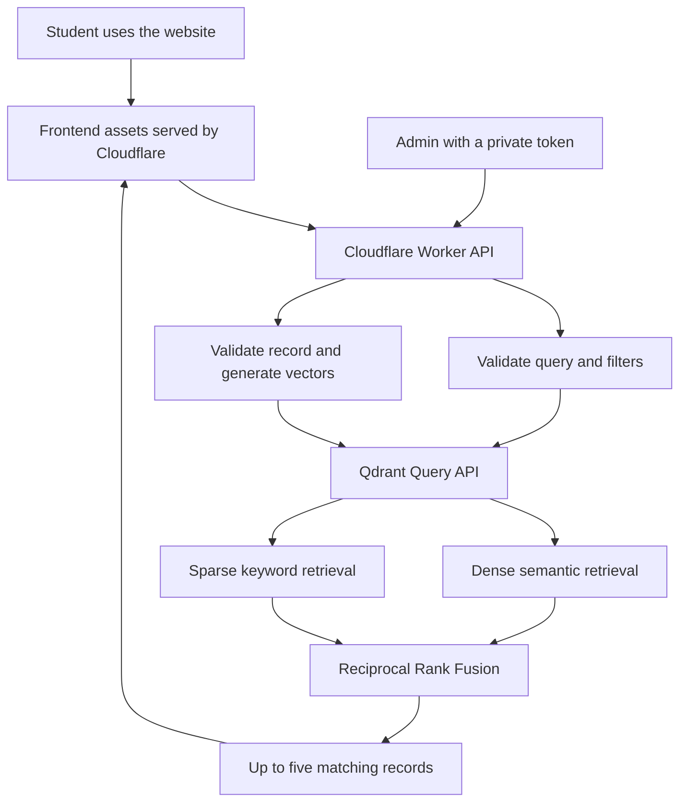

# Alumni Vector Database

### An alumni discovery website built with Qdrant and Cloudflare Workers

I developed this project as a database mini project to explore how a vector database can help students find alumni, mentoring opportunities and jobs using everyday language. Instead of requiring an exact name or keyword, the website accepts a description of what the student needs and returns related records.

For example, a student can search for **"someone who can help with my machine learning project"** and explore relevant alumni profiles. They can also choose Mentoring or Jobs to look for guidance or opportunities.

**Live website:** [Alumni Vector Console](https://alumni-vector-console.dakshx.workers.dev)

**Repository:** [daksh1403/alumni-vector-database](https://github.com/daksh1403/alumni-vector-database)

This repository includes the complete frontend, the Cloudflare Worker API, the Qdrant integration, migration and seed scripts, tests and deployment configuration. Database credentials and private exports are excluded.

## Contents

- [Project aim](#project-aim)
- [Features](#features)
- [Why I used Qdrant](#why-i-used-qdrant)
- [Technology stack](#technology-stack)
- [System architecture](#system-architecture)
- [How the search works](#how-the-search-works)
- [Database design](#database-design)
- [Dataset and migration](#dataset-and-migration)
- [Using the website](#using-the-website)
- [Run the project locally](#run-the-project-locally)
- [API reference](#api-reference)
- [Deploy to Cloudflare](#deploy-to-cloudflare)
- [Testing and evaluation](#testing-and-evaluation)
- [Project structure](#project-structure)
- [Security and data handling](#security-and-data-handling)
- [Limitations](#limitations)
- [Future improvements](#future-improvements)
- [What I learned](#what-i-learned)
- [References](#references)

## Project aim

An alumni network contains useful information about skills, departments, careers and mentoring. However, students may not know the exact terms used in a profile. Searching only for exact words can miss useful connections.

My aim was to build a small application that understands related ideas while still supporting precise filters. I also wanted to extend the earlier alumni project beyond its relational and graph database implementations and demonstrate a practical use of a modern database technology.

The main focus of this version is **discovery through semantic and keyword search**. It is a student demonstration, not a verified recruitment platform or a complete production alumni management system.

## Features

- Search for alumni, mentoring and jobs using natural language.
- Combine semantic search with keyword search for more useful rankings.
- Filter results by record type, department, skill, location and demo status.
- Show up to five search results at a time to keep the interface manageable.
- Browse records without entering a search, with pagination for additional records.
- Open details to read descriptions, skills and related record references.
- Create, edit and delete records through protected admin operations.
- Generate updated embeddings when an admin saves a record.
- Preserve original properties and connection references during Neo4j migration.
- Clearly label synthetic records as Demo in the interface.
- Use a responsive frontend with readable typography, an animated network visual, animation controls and reduced-motion support.

## Why I used Qdrant

Qdrant stores and searches numerical representations of information called vectors. Similar ideas can have nearby vector representations even when their wording differs.

For this project, a query about "container orchestration" can be related to a profile mentioning Kubernetes. This is useful when students describe a goal rather than searching for an exact database value.

| Requirement | How it is handled in this project |
| --- | --- |
| Find related ideas | Dense embeddings support semantic similarity search |
| Keep specific terms relevant | BM25 sparse vectors support keyword retrieval |
| Restrict matches to the right category | Payload filters apply to both retrieval paths |
| Store profile details beside searchable vectors | Payloads contain descriptions, skills and other metadata |
| Update searchable records | Upserts store the payload and newly generated vectors |
| Connect a serverless application | The Worker calls Qdrant through its HTTPS API |

A relational database is still suitable for structured records, joins and transactions. Qdrant suits this version because its main task is similarity-based discovery. I am not claiming that a vector database is better for every alumni management feature.

Qdrant does not execute SQL or Cypher. The application uses JavaScript and HTTPS requests, so JDBC is not part of this implementation.

## Technology stack

| Part | Technology | Purpose |
| --- | --- | --- |
| Frontend | HTML, CSS and JavaScript | Search interface, filters, record details and admin forms |
| Typography | Self-hosted Manrope fonts and a Georgia heading accent | Readable text and a distinct visual style |
| Backend | Cloudflare Workers | Request validation, API routes and access control |
| Database | Qdrant Cloud | Vector storage, payload filtering and retrieval |
| Dense model | `sentence-transformers/all-minilm-l6-v2` | 384-dimensional text embeddings |
| Sparse model | `qdrant/bm25` | Keyword-based sparse retrieval |
| Result fusion | Reciprocal Rank Fusion, or RRF | Combine dense and sparse result rankings |
| Development and deployment | Node.js, npm and Wrangler | Local development, scripts and Cloudflare deployment |
| Automated checks | Node.js test runner and GitHub Actions | Backend tests and deployment dry runs |

The application requests inference through Qdrant. It does not run a model inside the browser or require a separately configured paid embedding API. Availability and usage limits depend on the Qdrant and Cloudflare accounts used for deployment.

## System architecture



The browser sends requests to `/api/` on the same website origin. The Worker reads server-side secrets and communicates with Qdrant. The Qdrant API key is never needed in frontend code.

## How the search works

1. The student chooses Alumni, Mentoring or Jobs and enters a description.
2. The Worker validates the text and optional filters.
3. Qdrant uses the configured models to represent the query for dense and sparse retrieval.
4. Dense retrieval looks for similar meanings. Sparse retrieval looks for relevant terms.
5. Each retrieval path requests up to 30 candidates, with the selected filters applied.
6. RRF combines the two ranked candidate lists.
7. The API returns up to five records with their payloads, and the frontend displays them.

Dense retrieval uses exact search for this small dataset. RRF combines ranks rather than treating the raw scores from different retrieval methods as directly comparable.

The returned ranking score is **not a probability or a match percentage**. The website therefore presents the records in relevance order without displaying a misleading confidence percentage.

When a record is created or edited, its searchable text combines its type, title, description, skills, department and location. The application generates both vector representations before completing the upsert.

## Database design

The default collection is `alumni_network_v1`.

| Collection setting | Value |
| --- | --- |
| Dense vector name | `dense` |
| Dense dimensions | `384` |
| Dense distance | Cosine |
| Sparse vector name | `bm25` |
| Sparse modifier | IDF |
| Point identifier | Stable UUID for seeded records; random UUID for admin-created records |

Each point stores its vectors and a payload. The following is an illustrative payload, not a real student or alumnus record:

```json
{
  "kind": "alumni",
  "title": "Demo alumnus interested in machine learning",
  "description": "Synthetic alumni profile offering guidance on Python and machine learning projects.",
  "skills": ["python", "machine learning"],
  "department": "cse",
  "location": "bengaluru",
  "synthetic": true,
  "origin": "synthetic-demo",
  "topic": "machine learning",
  "relationships": []
}
```

Payload indexes are created for `kind`, `department`, `skills`, `location`, `synthetic` and `source_id`.

Supported record kinds are `alumni`, `job`, `mentorship`, `student`, `department`, `batch`, `company`, `skill`, `event` and `donation`. The primary website choices focus on Alumni, Mentoring and Jobs. The other record types can be accessed through advanced filters and linked details.

## Dataset and migration

The original demonstration collection was seeded with **101 records**:

| Category | Records |
| --- | ---: |
| Alumni | 50 |
| Jobs | 20 |
| Mentoring | 15 |
| Other original entities | 16 |
| Total | 101 |

Of these, 22 entities came from the earlier Neo4j dataset and 79 were synthetic additions. The migrated export contained 33 directed relationships. Counts can change after admin edits or reseeding.

Original properties are retained in `source_properties`. Connections are stored as references containing the relationship type, direction, target point ID and relationship properties.

These references preserve migration context, but they do not turn Qdrant into a graph database. The application opens a referenced record by ID instead of performing native graph traversal. Connected migrated records are protected from deletion through the admin API until their references are deliberately handled.

Private exports are not included in this repository. A fresh seed without the migration file creates **85 synthetic records**: 50 alumni, 20 jobs and 15 mentoring records. This allows another student to run the project without access to the original dataset.

Demo alumni, jobs and mentoring records are learning examples. They do not represent verified people, vacancies or available mentoring sessions.

## Using the website

1. Open the [live website](https://alumni-vector-console.dakshx.workers.dev).
2. Choose Alumni, Mentoring or Jobs.
3. Describe what you need, such as "help improving my design portfolio".
4. Select Search or press Enter.
5. Select View details on a result to read more.

Example buttons provide ready-made searches. Add filters narrows the search by exact metadata values. Browse lets the student explore records without a query, and Show 5 more loads another page.

Admin tools are collapsed by default. An administrator can enter the private admin token to add records and access editing or deletion controls. The database API key should never be entered into this form.

## Run the project locally

### 1. Prerequisites

- Node.js 22 or later and npm.
- A Qdrant Cloud cluster with access to the configured inference models.
- A database API key for that cluster.
- A Cloudflare account for deployment.

### 2. Clone and install

```sh
git clone https://github.com/daksh1403/alumni-vector-database.git
cd alumni-vector-database
npm ci
cp .env.example .dev.vars
```

The repository is private. Cloning requires an authenticated GitHub account with access.

### 3. Configure local secrets

Edit `.dev.vars` locally:

```dotenv
QDRANT_URL=https://your-cluster.cloud.qdrant.io
QDRANT_API_KEY=your-database-api-key
VECTOR_ADMIN_TOKEN=your-own-long-random-token
```

`QDRANT_URL` must be the HTTPS cluster origin without a collection path. The placeholders above are examples only. Generate a separate admin token, for example with `openssl rand -hex 32`.

Keep `.dev.vars` out of Git. The default collection and model are configured in `wrangler.jsonc`.

### 4. Seed demonstration data

```sh
npm run seed
```

The script creates the collection if it is missing, creates payload indexes and uploads records in batches. It writes the generated dataset to ignored `private/dataset.json`.

Repeated seeding uses stable IDs and upserts the same seeded points. It does not delete the collection or unrelated points, but it can replace edits to matching seeded records. Keep a backup before reseeding data that has been edited.

### 5. Start the complete website

```sh
npm exec -- wrangler dev --assets frontend
```

Open the local URL printed by Wrangler. This serves the committed frontend and runs API routes through the Worker.

For backend-only development, use `npm run dev`. Without an assets binding, the root path returns API information instead of the website.

### Optional: migrate an existing Neo4j dataset

Store `NEO4J_URI`, `NEO4J_DATABASE`, `NEO4J_USERNAME` and `NEO4J_PASSWORD` in a separate private environment file. Then run:

```sh
node --env-file=/absolute/path/to/neo4j.env scripts/export-neo4j.js
npm run seed
```

The exporter writes `private/migrated-graph.json`. It supports the ten original node labels and rejects unknown labels instead of silently omitting them. The seed script includes migrated entities and fills the three core categories to their target sizes.

An existing Neo4j instance is not required to run the synthetic demonstration. D1 is also not used by this version.

## API reference

| Method | Endpoint | Purpose | Access |
| --- | --- | --- | --- |
| GET | `/api/health` | Check collection connectivity | Public |
| GET | `/api/stats` | Read collection and category counts | Public |
| GET | `/api/facets` | Read available filter values | Public |
| POST | `/api/search` | Run hybrid search | Public |
| GET | `/api/records` | Browse up to five records per page | Public |
| GET | `/api/records/:uuid` | Read a record and its references | Public |
| POST | `/api/records` | Create and index a record | Admin token |
| PUT | `/api/records/:uuid` | Replace editable fields and regenerate vectors | Admin token |
| DELETE | `/api/records/:uuid` | Delete an unconnected record | Admin token |

### Search request

```sh
curl http://localhost:8787/api/search \
  -H 'Content-Type: application/json' \
  -d '{"query":"help with a Python machine learning project","kind":"alumni","department":"cse","skill":"python"}'
```

Use the actual local port printed by Wrangler if it differs from 8787.

The query must contain 1 to 1000 characters. Optional fields are `kind`, `department`, `skill`, `location`, `synthetic` and `limit`. A requested limit is capped at five. Unknown search fields are rejected.

Filter values are exact metadata matches after normalisation, not natural-language queries. `synthetic` must be a JSON boolean in a search request.

The response contains `results`, `elapsedMs`, `limit`, `method` and `scoreNote`. Each result contains its point ID, ranking score and payload. The API does not return stored vectors to the browser.

### Browse request

```text
GET /api/records?kind=alumni&skill=python&synthetic=false
```

The response contains `results` and `nextOffset`. Pass the returned `nextOffset` as `offset` to fetch the next page. Browse pagination is separate from the five-result search cap.

### Create or update a record

Admin requests require:

```text
Authorization: Bearer <VECTOR_ADMIN_TOKEN>
Content-Type: application/json
```

Example request body:

```json
{
  "kind": "mentorship",
  "title": "Demo Python project mentoring",
  "description": "Synthetic mentoring sessions focused on Python projects, debugging and practical portfolio feedback.",
  "skills": ["python", "debugging"],
  "department": "cse",
  "location": "remote",
  "synthetic": true
}
```

A record requires a supported kind, a non-empty title of at most 160 characters and a description of 20 to 4000 characters. It can contain up to 20 skills. Department, location and skills are normalised for filtering. Updates preserve existing source metadata and relationship references.

## Deploy to Cloudflare

First authenticate with Cloudflare:

```sh
npm exec -- wrangler login
```

**Before deploying from a new account or creating another site, change `name` in `wrangler.jsonc` to your own Worker name.** The committed name identifies the existing project. Keep the collection and embedding model consistent between seed scripts and Worker configuration.

Set server-side secrets using Wrangler's prompts:

```sh
npm exec -- wrangler secret put QDRANT_URL
npm exec -- wrangler secret put QDRANT_API_KEY
npm exec -- wrangler secret put VECTOR_ADMIN_TOKEN
```

Deploy the complete website and API:

```sh
npm run deploy:site
```

This command uploads `frontend/` as Worker assets and binds it as `ASSETS`. API requests still run through the Worker. The generated deployment configuration is temporary.

For an intentionally API-only deployment, use `npm run deploy:api`. Running that command on the same Worker after a full-site deployment removes its frontend assets, so use `deploy:site` when updating the website.

Publishing code to GitHub does not automatically deploy the website. The included GitHub Actions workflow runs checks only.

## Testing and evaluation

Run the backend tests and deployment check:

```sh
npm test
npm run deploy:site -- --dry-run
```

The suite contains 13 tests covering migration preservation, demo provenance, hybrid query construction, filters, result limits, transport authentication, metadata preservation and API validation. These checks run on GitHub pushes and pull requests.

After configuring and seeding Qdrant, run:

```sh
npm run evaluate
```

The evaluator sends ten curated topic queries, checks expected topics in the top three results, validates exact filtering and compares migrated payloads when the local dataset is available. It saves results to ignored `private/evaluation.json`. Its dataset count check expects the collection to match the seeded dataset, so use a dedicated demonstration collection when evaluating.

During the original implementation, all ten curated queries returned the intended topic first. The initial median backend time was 168 ms, with a maximum of 622 ms. These are historical measurements from a small developer-selected dataset, not an independent benchmark or a promise about current response time.

Previous integration checks also exercised real Qdrant CRUD operations, authorization and connected-record protection. Browser checks covered search, filters, details, responsive layout, animation controls and reduced-motion behaviour. Private browser scripts and their screenshots are not included in this repository, and GitHub Actions does not run those live checks.

## Project structure

```text
alumni-vector-database/
├── .github/workflows/test.yml   # Automated backend checks
├── .env.example                # Placeholder configuration only
├── .gitignore                  # Excludes secrets and private generated data
├── docs/
│   ├── implementation-plan.md  # Original backend implementation plan
│   └── verification.md         # Historical validation notes
├── frontend/
│   ├── index.html             # Complete website markup
│   ├── vector.css             # Styling, responsiveness and animations
│   ├── app.js                 # Search, filters, details and admin interactions
│   └── fonts/                 # Self-hosted fonts and their license
├── scripts/
│   ├── data.js                # Synthetic data and migration mapping
│   ├── seed.js                # Collection, indexes and point upserts
│   ├── export-neo4j.js         # Optional private Neo4j export
│   ├── evaluate.js            # Live retrieval evaluation
│   └── deploy-site.js         # Deploy frontend assets with the Worker
├── src/
│   ├── worker.js              # HTTP routes and admin authorization
│   ├── qdrant.js              # Qdrant transport and model configuration
│   └── search.js              # Validation, filters and hybrid search body
├── tests/                     # Node.js unit tests
├── package.json
├── package-lock.json
├── wrangler.jsonc
└── README.md
```

## Security and data handling

- Database credentials are read by the Worker from server-side secrets.
- Local configuration files, migration exports and generated reports are ignored by Git.
- Admin writes require a separate bearer token. Student browsing and searching are public.
- Request sizes, record fields and query input are validated.
- Search text is sent as model input, not as executable SQL or Cypher.
- The frontend uses text-based DOM rendering for record content.
- The Worker applies a content security policy to served frontend assets.
- Self-hosted font files include the Manrope Open Font License.

The public details API returns record payloads, including preserved `source_properties` for migrated records. Those properties may contain personal information from the source export. Only use data approved for public display, and remove sensitive fields before importing a real alumni dataset. Admin authentication does not make public read endpoints private.

## Limitations

- The application searches the records stored in its collection. It does not search the wider internet.
- Search results are capped at five per request. Browse supports additional pages.
- A fresh clone has synthetic seed data, not the private original migration export.
- Most records in the original demonstration collection are synthetic.
- Record details do not provide messaging, job applications or mentor booking.
- There is no student sign-in, individual admin account system or role management.
- The backend does not implement application-level rate limiting. Hosting and database limits still apply.
- Qdrant does not provide the relational joins or native graph traversals used by the earlier database versions.
- Network latency, inference startup and account capacity affect response time.
- The small relevance evaluation does not establish performance on a large real-world alumni dataset.

## Future improvements

These are planned ideas, not current features:

- Student authentication and individual admin accounts.
- Consent-based import and editing of real alumni profiles.
- Application-level rate limiting and request monitoring.
- A larger, independently labelled search evaluation dataset.
- User feedback on result usefulness.
- Mentor contact, booking and job application workflows.
- Automated browser checks in continuous integration.
- Retrieval tuning and load testing for larger collections.

## What I learned

This project helped me understand the difference between storing structured records and retrieving information by similarity. I learned how dense embeddings and keyword retrieval can complement each other, how payload indexes support exact filters and why ranking scores should not be presented as confidence percentages.

The migration also showed me that preserving old data does not mean preserving every capability of the old database. Relationship references can be retained in payloads, while graph traversal still requires a different approach.

I also gained practical experience with serverless APIs, protected admin operations, environment secrets, reproducible seed scripts, deployment and testing against a real hosted database.

## References

- [Qdrant documentation](https://qdrant.tech/documentation/)
- [Qdrant inference API documentation](https://qdrant.tech/documentation/inference/inference-api/)
- [Qdrant Query API](https://api.qdrant.tech/api-reference/search/query-points)
- [Cloudflare Workers documentation](https://developers.cloudflare.com/workers/)
- [Wrangler commands](https://developers.cloudflare.com/workers/wrangler/commands/)
- [MiniLM model information](https://huggingface.co/sentence-transformers/all-MiniLM-L6-v2)
